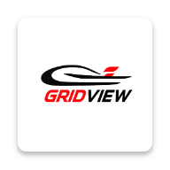

# GridView

**Follow the Formula 1 season on Android.**

GridView brings the race calendar, weekend schedules, championship standings and
information about drivers, teams and circuits into one app. The rebuild puts
saved information first, so checking a session time or revisiting a result does
not depend on a fresh network request every time.

[Google Play](https://play.google.com/store/apps/details?id=com.sejuma.gridview) ·
[Features](#the-season-at-a-glance) ·
[Development](#getting-started) ·
[Documentation](#documentation)

> **The app is being rebuilt for 2.0.0.** The features below describe the
> implementation in this repository, which has not yet been released on Google
> Play. The last confirmed public version is 1.2.1; its legacy backend is no
> longer working. See [project status](#project-status) before downloading.

## The season at a glance

- **Know what comes next.** Home brings together the next Grand Prix, session
  timing, championship leaders, the latest available race result and upcoming
  events.
- **Plan the race weekend.** Browse the season calendar and open a Grand Prix
  for its circuit, weekend information and session schedule. Display times in
  your device's time zone, the event's time zone when supplied, or both.
- **Follow the championship.** Switch between Drivers' and Constructors'
  standings, with points and links to the people and teams behind them.
- **Revisit the race.** Open a Grand Prix to read its published race
  classification. The 2.0.0 release scope includes the full weekend schedule
  but race results only; results for other session types are deferred.
- **Explore the grid.** Browse drivers, teams and circuits, then open their
  profiles for available season, line-up and circuit information.
- **Make it comfortable to read.** Choose English or Spanish, a light or dark
  theme, or follow your system settings. Language, appearance and time-display
  preferences persist between visits.

Home, Calendar, Standings and Explore form the four main sections. Switching
between them preserves your place, making it easy to move from the season
summary into a weekend or a profile and back again.

## Useful when you're offline

The rebuild saves downloaded season information on your device. Previously
loaded calendars, standings, profiles and results can be read offline, and a
failed refresh keeps that saved information intact.

On launch, the interface displays local content before checking for updates.
Synchronization also checks what needs refreshing when you return to the app;
manual refresh and on-demand detail loading are supported. These checks run
alongside the interface while the app is active, rather than through a permanent
background service.

Freshness notices and the last successful check help distinguish saved data
from a recent check. A first download, an uncached detail or a new result still
needs a connection and an available backend. Images have a separate cache, so
missing images do not prevent access to the text and data.

## Project status

Status reviewed against repository evidence on **6 November 2026**.

| Track | Status |
| --- | --- |
| Google Play | **1.2.1 (7)** is the last confirmed public release, recorded again in the [release evidence](docs/release/data-safety.md) on 5 November 2026. The public listing remains accessible. |
| Rebuild | **2.0.0+8**, as declared in [pubspec.yaml](pubspec.yaml). The main screens, local persistence, settings and client synchronization are implemented, but unreleased. |
| Data delivery | Jolpica integration and the automatic update pipeline are implemented. Reviewed real-data batches have reached staging; automatic publication against the real provider remains blocked by rate-limit refusals. |
| Production backend | The last recorded deployment is an initial setup with no published season data. Production automatic updates are not active. |

The next priorities are to validate reliable automatic data delivery in staging,
activate and verify it in production, complete privacy and Google Play Data
safety requirements, and finish release-candidate checks. The planned release
updates the existing app through a staged production rollout; the owner will
verify the Play-delivered upgrade and live performance before expanding it to
100%. No release date is committed.

The media pipeline is implemented, but Formula 1 imagery has not been cleared
for publication. Driver portraits, team imagery and circuit layouts are not
promised for this release. Android is the supported platform; there is no iOS
release plan in scope.

See the [implementation plan](docs/technical/GridView_Implementation_Plan.md),
[automatic update release gates](docs/release/automatic-updates.md) and
[2.0.0 release plan](docs/release/production-release-plan.md) for the detailed
acceptance criteria and dated evidence.

## How it is built

The Flutter client reads from a local database. Its repositories fetch normalized
snapshots from the GridView API and apply each accepted resource update in a
transaction. The backend owns provider access, validation and publication;
opening a mobile screen does not call an external Formula 1 provider directly.

| Layer | Technology and responsibility |
| --- | --- |
| Android app | Flutter and Dart, Riverpod for state and dependencies, GoRouter for navigation |
| Local data | Drift over SQLite for season data; persisted preferences for settings |
| Client synchronization | Dio, conditional HTTP requests and ETags to avoid downloading unchanged resources |
| Edge API | TypeScript on Cloudflare Workers; versioned snapshots in Workers KV; Durable Objects for provider rate limiting, publication sequencing and reconciliation state |

The backend serves published snapshots rather than fetching provider data for
each reader. Automatic provider polling is a separate pipeline whose production
activation is still pending. Production builds also integrate Firebase
Crashlytics and Performance Monitoring; dev and staging do not activate
collection.

The repository is a monorepo: [lib/](lib/) contains the Flutter app,
[android/](android/) its Android project, [services/edge-api/](services/edge-api/)
the Worker, [content/](content/) curated records and attribution, and
[test/](test/) the client tests. Product and engineering specifications live in
[docs/](docs/).

## Getting started

### Toolchain

Use **Flutter 3.44.0**, pinned in [.fvmrc](.fvmrc), with Dart **3.12.x**
(`pubspec.yaml` requires `^3.12.0`). Android development needs Android Studio or
the command-line SDK tools, SDK 36, NDK 27.0.12077973, a compatible JDK (17 or
later), and an emulator or device running Android 7.0 / API 24 or later.
The Worker uses **Node.js 22 and npm 10.9.9**.

From the repository root, with FVM installed:

```sh
fvm install
fvm flutter pub get
fvm flutter doctor
```

Generated Dart sources are tracked. When changing models or localization, follow
the generation steps in the [testing guide](docs/testing/README.md).

### Run against a local mock backend

In `services/edge-api`, run `npm ci`, copy `.dev.vars.example` to `.dev.vars`,
and replace its token value with a disposable local token. Start the Worker with
`npm run dev`, then follow its [local workflow](services/edge-api/README.md#local-workflow)
to seed the first mock snapshot from another terminal before opening the app.
This path needs no production credentials or real provider connection.

In another terminal at the repository root, run on an Android emulator:

```sh
fvm flutter run --flavor dev --dart-define=APP_ENV=development --dart-define=DATA_SOURCE=remote --dart-define=API_BASE_URL=http://10.0.2.2:8787
```

`10.0.2.2` is the Android emulator's address for the host machine. A physical
device needs an address it can reach. For local data and refresh troubleshooting,
see the [synchronization guide](docs/technical/GridView_Synchronization.md).

### Other development modes

**Staging:** use the separate staging app identity and public read API. Its data
may lag while provider validation is unfinished.

```sh
fvm flutter run --flavor staging --dart-define=APP_ENV=staging --dart-define=DATA_SOURCE=remote --dart-define=API_BASE_URL=https://gridview-api-staging.sejuma18.workers.dev
```

**Bundled fixtures:** no Worker is required, but this is currently a limited UI
development mode. Only Home and two Grand Prix fixtures are bundled; bootstrap
and current-season fixtures are missing, so season-scoped screens cannot load a
season on a fresh installation. Fixture builds show a sample-data notice.

```sh
fvm flutter run --flavor dev --dart-define=APP_ENV=development --dart-define=DATA_SOURCE=fixture
```

**Build a development APK** using the staging read API:

```sh
fvm flutter build apk --debug --flavor dev --dart-define=APP_ENV=development --dart-define=DATA_SOURCE=remote --dart-define=API_BASE_URL=https://gridview-api-staging.sejuma18.workers.dev
```

The available flavors are `dev`, `staging` and `production`. Local dev and staging
debug builds need neither release signing keys nor private Firebase configuration.
Production builds require owner-managed configuration and signing credentials;
they are not a reproducible public setup. The production identity must remain
`com.sejuma.gridview`. See [environment configuration](docs/technical/GridView_Environments.md)
and the release plan before working on production builds.

### Checks

From the repository root:

```sh
fvm flutter analyze
fvm flutter test
```

From `services/edge-api`:

```sh
npm run typecheck
npm run lint
npm run format
npm test
npm run validate
```

The [testing guide](docs/testing/README.md) covers contract, persistence, widget,
accessibility and visual regression checks. Linux CI is the reference environment
for regenerating golden images.

## Documentation

- **Product:** [requirements and scope](docs/product/GridView_PRD.md),
  [navigation and user flows](docs/product/GridView_App_Flow.md),
  [UI and UX design](docs/product/GridView_UI_UX_Design.md).
- **Architecture:** [technical design](docs/technical/GridView_TRD.md),
  [backend design](docs/technical/GridView_Backend_Scheme.md),
  [local persistence](docs/technical/GridView_Local_Data.md),
  [synchronization](docs/technical/GridView_Synchronization.md).
- **Contracts and decisions:** [OpenAPI specification](docs/api/gridview-api-v1.yaml),
  [domain model](docs/technical/GridView_Domain_Model.md),
  [architecture decision records](docs/adr/README.md).
- **Development:** [repository instructions](AGENTS.md),
  [environments](docs/technical/GridView_Environments.md),
  [tests and quality gates](docs/testing/README.md),
  [project scripts](scripts/README.md).

Canonical documents contain both design history and dated implementation notes.
For release readiness, use the release records linked above rather than older
phase summaries.

## Data, attribution and privacy

The implemented provider integration uses [Jolpica F1](https://github.com/jolpica/jolpica-f1).
Its data is published under [CC BY-NC-SA 4.0](https://creativecommons.org/licenses/by-nc-sa/4.0/)
and its [terms of use](https://github.com/jolpica/jolpica-f1/blob/main/TERMS.md).
GridView transforms, normalizes and combines provider data; derived material
remains available under that license wherever ShareAlike applies. GridView claims
no exclusive ownership of it. Jolpica has not reviewed or endorsed GridView and
does not guarantee data availability or correctness.

GridView's provider strategy is non-commercial. OpenF1 has been evaluated but is
not integrated into the current data path. These are post-race data workflows,
with no live timing or guaranteed result-delivery time. The data license does not
grant Formula 1 trademark or media rights. See the
[provider evaluation](docs/technical/GridView_Provider_Evaluation.md),
[data-source attribution record](content/attribution/data-sources.json) and
[API licensing notice](docs/api/README.md#data-sources-and-licensing).

The checked-in [privacy policy](privacy_policies.md), updated on 5 November 2026,
covers both versions 1.x and 2.0.0, including legacy SDK behavior and the rebuild's
production diagnostics. Publishing the updated policy at the store-linked URL
and submitting Google Play Data safety declarations remain pending, alongside
the outstanding privacy questions recorded in the [Data safety evidence](docs/release/data-safety.md)
and [owner self-assessment](docs/release/privacy-self-assessment.md). Updating
the policy in the repository does not complete those release requirements.

**GridView is an independent application. It is not associated with, endorsed by
or affiliated with Formula 1, the FIA or any team.**

## License and collaboration

This repository does not currently include a software license or a contribution
policy. Public visibility does not establish an open-source license, and the
provider data license above does not license GridView's application or backend
source code.

Before proposing substantial changes, discuss scope with the maintainer and
review [AGENTS.md](AGENTS.md), the product requirements and implementation plan.
Changes must preserve the existing Android application's identity and stay
within the accepted product scope.
