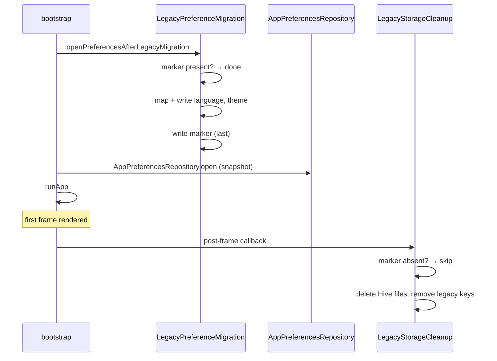

# GridView — Legacy preference migration (Phase 10)

How a device upgraded from the legacy app (`legacy-mobile-v1.2.1`, versionCode
7) is brought onto the reconstruction's storage. The decision record is
[ADR 0027](../adr/0027-legacy-preference-migration-and-storage-removal.md).

## 1. What the legacy app left on a device

Read from the legacy source, not from the plan:

| Item | Where | Type / values | Fate |
|---|---|---|---|
| `languageCode` | `shared_prefs/FlutterSharedPreferences.xml` as `flutter.languageCode` | String: `en` `es` `it` `pt` `fr` `de` `ca` | `en`/`es` migrated; others not; key removed after launch |
| `isDarkMode` | same file, `flutter.isDarkMode` | bool | migrated; key removed after launch |
| `cache.hive` | `getApplicationDocumentsDirectory()` (`app_flutter/`) | Hive 2.2.3 box `cache`: raw API bodies + `last_cache_update` | never read; deleted after launch |
| `cache.hivec` | same directory | interrupted Hive compaction | deleted after launch |
| `cache.lock` | same directory | Hive lock, left when the process was killed | deleted after launch |

There was **no consent state**, no image path and no other preference.
Advertising SDK residue (Google Mobile Ads, Unity Ads) is SDK-owned and out of
scope.

## 2. Mapping

| Legacy | Reconstruction | Why |
|---|---|---|
| `languageCode = en` | `gv.preference.language = english` | both pin English regardless of device locale |
| `languageCode = es` | `gv.preference.language = spanish` | both pin Spanish |
| `languageCode ∈ {it, pt, fr, de, ca}` | not written (default `system`) | language not offered |
| `isDarkMode = true` | `gv.preference.theme = dark` | explicit toggle |
| `isDarkMode = false` | `gv.preference.theme = light` | explicit toggle |
| key absent | not written (defaults `system` / `dark`) | the legacy defaults were not user choices |
| anything else | not written | invalid; never blocks startup, no diagnostic |

A reconstruction key that already holds a **valid** value is never overwritten;
one holding a corrupt value (unknown token, wrong type) is replaced by a valid
legacy choice, since it would otherwise render as the default and the legacy
choice would then be cleaned up. A key that cannot be **read** is never treated
as absent: the migration stays incomplete, so nothing is cleaned up, and the
next launch retries.

## 3. Lifecycle

| Component | File |
|---|---|
| Legacy keys, file names, marker, store seam | `lib/core/legacy/legacy_storage.dart` |
| Migration | `lib/core/legacy/legacy_preference_migration.dart` |
| Cleanup | `lib/core/legacy/legacy_storage_cleanup.dart` |
| Production startup steps | `lib/core/legacy/legacy_startup.dart`, wired in `lib/app/bootstrap.dart` |

Both steps are total (they never throw) and idempotent. A failed read, or a
failed value or marker write, leaves the migration incomplete and is retried
next launch; a failed write also raises the existing `writeFailure` preference
diagnostic. Cleanup does nothing until the marker exists, and a failed removal
is retried next launch.

## 4. Tests

| Case | Test |
|---|---|
| Populated (es/dark, en/light, each unsupported language) | `test/legacy/legacy_preference_migration_test.dart` |
| Empty | same, and `legacy_storage_cleanup_test.dart` |
| Corrupt values (wrong type, unknown code, region tag, case) and a throwing store | both |
| Corrupt / genuine Hive box, directory with a legacy name, unavailable directory | `legacy_storage_cleanup_test.dart` |
| Corrupt reconstruction key (`es` + corrupt language, `false` + corrupt theme, wrong type) | `legacy_preference_migration_test.dart` |
| Transient read failure (each legacy key, new key, marker) then retry; files and keys intact meanwhile | both |
| Repeated upgrade, marker missing with valid new keys set, failed writes/removals then retry | both |
| Cleanup only after the first frame | `test/app/legacy_cleanup_scheduling_test.dart` |
| No Hive dependency or import | `test/legacy/legacy_isolation_test.dart` |

The genuine Hive fixture and its provenance are in `test/fixtures/legacy/`.

## 5. Not covered by these tests

A real upgrade through Google Play — the §15.3 matrix in
`GridView_Implementation_Plan.md` — is still required: Play-signed 1.2.1
installed with each legacy state, then updated to the Play-signed
reconstruction, verifying package identity, signature, preferences, database
initialization, first useful screen, removal of the Hive files and later
launches.
